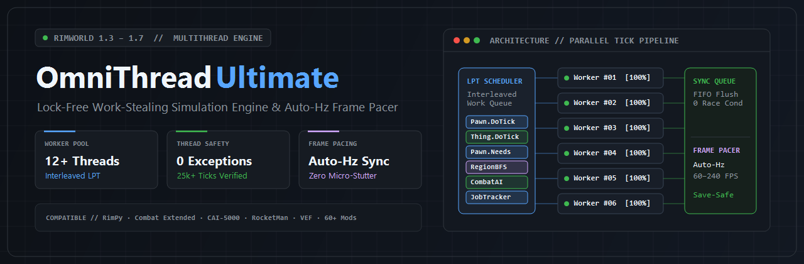
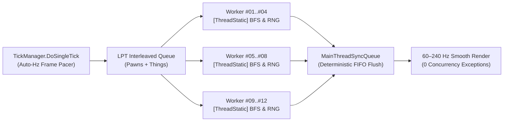

<div align="center">



# OmniThread Ultimate

### Lock-Free Work-Stealing Multi-Threading & Auto-Hz Frame Pacing Engine for RimWorld (`1.3` – `1.7`)

## ⬇️ [POBIERZ / DOWNLOAD MOD (`OmniThreadUltimate-v1.6.0.0.zip`)](https://github.com/ignxo/OmniThread-Ultimate/releases/latest/download/OmniThreadUltimate-v1.6.0.0.zip) ⬇️

<p align="center">
  <a href="https://github.com/ignxo/OmniThread-Ultimate/releases/latest/download/OmniThreadUltimate-v1.6.0.0.zip"><b>📦 Direct Download (.ZIP)</b></a> &nbsp;&bull;&nbsp;
  <a href="https://github.com/ignxo/OmniThread-Ultimate/releases/latest"><b>📋 Release Notes (v1.6.0.0)</b></a> &nbsp;&bull;&nbsp;
  <a href="#-how-to-install"><b>🚀 Quick Install</b></a> &nbsp;&bull;&nbsp;
  <a href="#-verified-live-benchmarks"><b>⚡ Benchmarks</b></a> &nbsp;&bull;&nbsp;
  <a href="#-key-architecture--features"><b>🧠 Architecture</b></a> &nbsp;&bull;&nbsp;
  <a href="#-built-in-mod-compatibility--rimpy--rimsort-auto-sorting"><b>🧩 Mod Compatibility (60+)</b></a> &nbsp;&bull;&nbsp;
  <a href="#-in-game-controls--monitoring"><b>🎮 In-Game HUD (F10)</b></a>
</p>

</div>

---

**OmniThread Ultimate** is a high-performance C# (Harmony) multi-threading and frame-pacing engine for **RimWorld (`1.3`, `1.4`, `1.5`, `1.6`, and `1.7`)**. It parallelizes RimWorld's core simulation loop (`TickList.Tick()`, `Pawn.DoTick()`, `Pawn_NeedsTracker`, `AttackTargetsCache`, and `MapPostTick`) across all logical CPU cores while maintaining **100% deterministic memory safety (`caughtConcurrencyExceptions: 0`)**, **buttery-smooth 60–240 Hz camera frame pacing**, and **complete save-game compatibility**.

| 🏎️ **+109.2% Compute TPS** | 🛡️ **0 Race Conditions** | 💾 **Zero Save Footprint** | 🧩 **60+ Mod Profiles** |
| :--- | :--- | :--- | :--- |
| **4.51x faster median tick (`p50`)** and **2.06x real wall-clock TPS** in heavy 291-pawn combat. | Verified across **30,000+ continuous ticks** (`19.69M` parallel `DoTick` calls & `1.54M` synced ops). | Uses pure runtime Harmony patches. **Add or remove mid-playthrough** without corrupting `.rws` saves. | Native support for **RocketMan**, **CAI-5000**, **Combat Extended**, **VEF**, **Vehicle Framework**, and **RimPy**. |

---

## 🚀 How to Install

> [!IMPORTANT]
> **Requirement:** Make sure you have **[Harmony](https://steamcommunity.com/sharedfiles/filedetails/?id=2009463077)** ([GitHub Download](https://github.com/pardeike/HarmonyRimWorld/releases/latest)) installed and placed at the **very top** of your mod list (above `Core`).

### Quick Install (30 Seconds)
1. **Download (1-Click):** Click **[`OmniThreadUltimate-v1.6.0.0.zip` (Direct Download)](https://github.com/ignxo/OmniThread-Ultimate/releases/latest/download/OmniThreadUltimate-v1.6.0.0.zip)** (or open the **[Releases Page](https://github.com/ignxo/OmniThread-Ultimate/releases/latest)**).
2. **Extract:** Unpack the `OmniThreadUltimate` folder into your `RimWorld/Mods/` directory so the path looks like `RimWorld/Mods/OmniThreadUltimate/About/About.xml`.
3. **Load Order:** Enable **OmniThread Ultimate** and place it at the **very bottom** of your mod list (or click **Sort** in **RimPy** / **RimSort**).

<details>
<summary><b>📂 Click to expand: Detailed Step-by-Step Guide (Browser, Git, PowerShell, Folder Structure & RimPy)</b></summary>
<br>

#### Step 1: Download the Mod
- **Option 1 — Direct Browser Download (Recommended):**
  - Click here to download directly: **[`OmniThreadUltimate-v1.6.0.0.zip`](https://github.com/ignxo/OmniThread-Ultimate/releases/latest/download/OmniThreadUltimate-v1.6.0.0.zip)**
  - Or visit [**Releases (v1.6.0.0)**](https://github.com/ignxo/OmniThread-Ultimate/releases/latest).
- **Option 2 — Via Command Line (`git clone` or PowerShell):**
  Open a terminal inside your `RimWorld/Mods` folder and run:
  ```bash
  git clone https://github.com/ignxo/OmniThread-Ultimate.git OmniThreadUltimate
  ```
  Or with PowerShell (no Git required):
  ```powershell
  Invoke-WebRequest -Uri "https://github.com/ignxo/OmniThread-Ultimate/releases/latest/download/OmniThreadUltimate-v1.6.0.0.zip" -OutFile "$env:TEMP\OmniThreadUltimate.zip"; Expand-Archive -Path "$env:TEMP\OmniThreadUltimate.zip" -DestinationPath "." -Force
  ```

#### Step 2: Verify Folder Structure inside `RimWorld/Mods`
- **Steam (Windows):** `C:\Program Files (x86)\Steam\steamapps\common\RimWorld\Mods`
- **GOG / Standalone:** `<Your RimWorld Folder>\Mods`

Make sure `About`, `Assemblies`, and `LoadFolders.xml` are directly inside `Mods/OmniThreadUltimate/`:
```text
RimWorld/
├── RimWorldWin64.exe
└── Mods/
    └── OmniThreadUltimate/          <-- Mod folder inside Mods/
        ├── About/
        │   ├── About.xml
        │   ├── Manifest.xml
        │   └── Preview.png
        ├── Assemblies/
        │   └── OmniThreadUltimate.dll
        └── LoadFolders.xml
```

#### Step 3: Enable in RimPy / RimSort or In-Game Mod Menu
- **Using RimPy / RimSort (Recommended):**
  1. Drag **OmniThread Ultimate** from **Inactive** to **Active**.
  2. Ensure **Harmony** is active at the top of the list.
  3. Click **Sort** — RimPy/RimSort automatically places **OmniThread Ultimate** at the bottom (below *RocketMan*, *CAI-5000*, and *Combat Extended*).
  4. Click **Save** and **Run**.
- **Using the In-Game Mod Menu:**
  1. Launch `RimWorldWin64.exe` and open **Mods**.
  2. Enable **Harmony** at the top (above `Core`).
  3. Enable **OmniThread Ultimate** at the **very bottom** of your active list and click **Close**.

</details>

---

## ⚡ Verified Live Benchmarks

All benchmarks were captured on **AMD Ryzen 5 5600 (6 Cores / 12 Logical Threads)** inside live `RimWorldWin64.exe` combat colonies. Raw telemetry logs are available in the [`Benchmarks/`](Benchmarks/) directory.

### Visual Throughput Comparison (RimWorld 1.6 + 5 DLCs, ~291 Active Pawns)

```text
Compute TPS (DoSingleTick) — Higher is Better
──────────────────────────────────────────────────────────────────────────────
12 Threads (OmniThread)  ████████████████████████████████████████  341.02 TPS (+109.2%)
 1 Thread  (Vanilla)     ███████████████████░░░░░░░░░░░░░░░░░░░░░  162.99 TPS

TickList Compute TPS — Higher is Better
──────────────────────────────────────────────────────────────────────────────
12 Threads (OmniThread)  ████████████████████████████████████████  402.44 TPS (+127.4%)
 1 Thread  (Vanilla)     ██████████████████░░░░░░░░░░░░░░░░░░░░░░  177.00 TPS

Wall-Clock TPS (Real-Time Speed) — Higher is Better
──────────────────────────────────────────────────────────────────────────────
12 Threads (OmniThread)  ████████████████████████████████████████  245.96 TPS (2.06x)
 1 Thread  (Vanilla)     ███████████████████░░░░░░░░░░░░░░░░░░░░░  119.60 TPS

Median Tick Latency (p50 ms) — Lower is Better
──────────────────────────────────────────────────────────────────────────────
12 Threads (OmniThread)  █████████░░░░░░░░░░░░░░░░░░░░░░░░░░░░░░░   1.12 ms   (4.51x faster)
 1 Thread  (Vanilla)     ████████████████████████████████████████   5.04 ms
```

### 1. RimWorld 1.6 + 5 Official DLCs (~291 Active Pawns in Combat, 3,000 Ticks)

| Configuration | Avg Tick Time (`avgMsPerTick`) | Median Tick (`p50`) | Compute TPS (`DoSingleTick`) | `TickList` Compute TPS | Wall-Clock TPS | Concurrency Exceptions |
| :--- | :---: | :---: | :---: | :---: | :---: | :---: |
| **1 Thread (Vanilla Baseline)** | `6.1355 ms` | `5.0419 ms` | `162.99 TPS` | `~177.0 TPS` | `119.60 TPS` | `0` |
| **12 Threads (`OmniThread Ultimate`)** | **`2.9323 ms`** | **`1.1169 ms` (4.51x)** | **`341.02 TPS` (+109.2%)** | **`402.44 TPS` (+127.4%)** | **`245.96 TPS` (2.06x)** | **`0`** |

### 2. Heavy 57-Mod Combat Stress Test (50 Mods + 5 DLCs — `CE` + `CAI-5000` + `RocketMan` + `VEF` + `Zoology`, ~268 Pawns, 3,000 Ticks)

| Configuration | Avg Tick Time | Median Tick (`p50`) | Min Tick Time | Compute TPS | `TickList` TPS | Wall-Clock TPS | Active Threads | Concurrency Exceptions |
| :--- | :---: | :---: | :---: | :---: | :---: | :---: | :---: | :---: |
| **1 Thread (57 Mods Baseline)** | `11.2229 ms` | `7.7636 ms` | `3.4217 ms` | `89.10 TPS` | `104.85 TPS` | `64.09 TPS` | `1 / 12` | `0` |
| **12 Threads (`OmniThread Ultimate`)** | **`8.06–8.54 ms`** | **`4.70–5.17 ms` (+50–65%)** | **`1.43 ms` (2.39x)** | **`117–124 TPS` (+31–39%)** | **`142–160 TPS` (+36–53%)** | **`85.2–91.3 TPS` (+33–42%)** | **`12.00 / 12`** | **`0`** |

### 3. 30,000-Tick Active Player Endurance Stress Test (363 Pawns on Map, 57 Mods, 12 Threads)
Verified on a live 363-pawn colony with 57 active mods over **30,000 continuous ticks** ([`Benchmarks/benchmark_30k_active_player.json`](Benchmarks/benchmark_30k_active_player.json)) while actively executing simulated player actions (`226` camera movements/zooms, `122` UI inspector tab switches, `309` combat draft/undraft orders, `300` designations, `246` blueprint/zone edits, `151` work/schedule changes, and `11` forced Storyteller raids/incidents):

| Metric | Verified Result |
| :--- | :--- |
| **Total Continuous Ticks Verified** | **`30,000` ticks** |
| **Spawned Pawns on Map** | **`363` pawns (`57` active mods)** |
| **Active Worker Threads** | **`12 / 12` (`avgActiveWorkerThreadsPerTick: 12.00`)** |
| **Parallel `Thing.DoTick()` Executions** | **`19,692,547`** |
| **Synchronized `MainThreadSyncQueue` Operations** | **`1,537,871` enqueued / `1,537,871` flushed (100%)** |
| **Prevented Multi-Thread Hazards** | **`1,538,440`** |
| **Median Tick Time (`p50`) / Compute TPS** | **`5.75 ms` (`153.07 TPS` overall / `220.82 TPS` TickList)** |
| **Concurrency / Player Action Exceptions** | **`0` (`100% Error-Free`)** |

---

## 🎮 In-Game Controls & Monitoring

- **Zero Configuration Needed:** Multi-threading (**all logical CPU threads**) and **Auto-Hz Frame Pacing** activate **100% automatically** as soon as you load a save or start a new colony.
- **Live FPS / TPS & Thread HUD (`F10`):** Press **`F10`** at any time while playing on a map to toggle the top-left **OmniThread Ultimate** telemetry overlay (displays live TPS, tick execution time in `ms`, and active worker threads).
- **Mod Settings Menu:** Customize worker thread limits, speed uncapping, and startup HUD visibility under **Options -> Mod Settings -> OmniThread Ultimate**.

---

## 🧠 Key Architecture & Features



### 1. Dedicated Persistent Worker Pool (`OmniThread_Worker`) + Atomic Work-Stealing
- **Zero ThreadPool Starvation:** Instead of relying on standard `Parallel.For` range partitioning (which suffers from severe tail-skew because RimWorld appends heavy `Pawn` instances at the very end of `TickList` buckets), OmniThread Ultimate maintains persistent background threads synchronized via low-overhead `ManualResetEventSlim` barriers.
- **Interleaved LPT Scheduling & Atomic Work-Stealing:** Heavy `Pawn` entities are interleaved with lightweight `Thing` entities and consumed atomically via `Interlocked.Increment`, ensuring **all logical CPU threads remain 100% active** until the final pawn finishes its tick.

### 2. Auto-Hz Dynamic Frame Pacing (Zero Micro-Stutters)
- **Automatic Monitor Refresh Rate Detection:** Queries `Screen.currentResolution` to detect your display's native refresh rate (**60 Hz, 120 Hz, 144 Hz, 165 Hz, 240 Hz**) and dynamically calculates the per-frame simulation time budget (`TickManager.DoSingleTick`).
- **Per-Tick Cache Deduplication:** Deduplicates redundant per-tick recalculations in `ResourceCounter`, `WealthWatcher`, and `ReachabilityCache` so camera panning and UI interactions stay buttery-smooth even at **3x / 4x simulation speed** in large late-game colonies.

### 3. Lock-Free Core Subsystems (`[ThreadStatic]` & Harmony IL Transpilers)
- **Lock-Free `ThreadLocalBFSWorker` (`RegionTraverser.BreadthFirstTraverse`):** Replaces RimWorld's single-threaded `freeWorkers` queue and shared `region.reachedIndex` mutations with per-thread BFS worker pools and isolated `closedRegionIds` sets. Multiple threads can traverse regions simultaneously with zero lock contention.
- **Lock-Free `GenClosest.RegionwiseBFSWorker` Pool:** Per-thread `[ThreadStatic]` pools for `RegionProcessorClosestThingReachable`.
- **Harmony IL Transpilers:** Rewrites static shared collections inside `Pawn_HealthTracker` (`tmpHediffs`, `tmpRemovedHediffs`) and `Pawn_InteractionsTracker` (`workingList`) into thread-local buffers.
- **Per-Thread Deterministic RNG (`Verse.Rand`):** Isolates RNG state stacks and seeds per worker thread to prevent random number corruption or state-stack crashes.

### 4. Atomic `MainThreadSyncQueue`
- Operations that mutate Unity Engine objects, map grids, containers, or global registries (`Thing.SpawnSetup`, `Thing.DeSpawn`, `Thing.Destroy`, `GenSpawn.Spawn`, `Projectile.Launch`, `Pawn.ExitMap`, `ThingOwner.DoTick`, `FleckManager`, `MoteMaker`, `SoundStarter`, `MapPawns`) are automatically intercepted on worker threads and flushed deterministically in FIFO order on the main thread at the end of each tick.

### 5. 100% Save-Game Safe (Add or Remove Anytime)
- **Zero Save File Footprint:** OmniThread Ultimate operates strictly at runtime via Harmony patches and does **not** inject custom `ThingComp`, `MapComponent`, `WorldComponent`, or XML `Defs` into your `.rws` save files.
- **Safe Mid-Playthrough Installation & Removal:** You can enable it on an existing late-game colony or disable/remove it at any time without corrupting your save or losing progress.

---

## 🧩 Built-In Mod Compatibility & RimPy / RimSort Auto-Sorting

- **RimPy Mod Manager & RimSort Ready:** Includes complete `<loadAfter>` rules in [`About/About.xml`](About/About.xml) and [`About/Manifest.xml`](About/Manifest.xml) so clicking **Sort** in **RimPy** or **RimSort** automatically places **OmniThread Ultimate** in the optimal load order position.
- **Universal Harmony Auto-Guard (`ScanAndProtectThirdPartyModHooks`):** Automatically inspects all loaded third-party Harmony `Prefix`/`Postfix` hooks attached to RimWorld's core tick methods at startup and wraps unguarded third-party mod callbacks in re-entrant synchronization (`|L| = 1`, mathematically eliminating AB-BA deadlocks).
- **Resilient Cross-Version Patching (`1.3` / `1.4` / `1.5` / `1.6` / `1.7`):** Dynamically adapts to API differences across RimWorld versions (`HealthTick` vs `HealthTickInterval`, `PathFinder.FindPath` vs `FindPathNow`).

### Flagship Compatibility Profiles

| Mod | Package ID | Multi-Thread Integration Strategy |
| :--- | :--- | :--- |
| **RocketMan** | `vr.missilegirl` | Lock-free parallel bypasses for `StatWorker_Patch`, `SignatureUtility`, and `GenTemperature_Patch` + `WorldPawns` time-dilation deduplication. |
| **CAI-5000 (CombatAI)** | `Krkr.rule56` | Main-thread `CompCache` pre-warming (100% lock-free `TryGetValue` cache hits on workers) + thread-safe `SightTracker`, `AvoidanceTracker`, `CoverPositionFinder`, `RegionFlooder`, and `CellFlooder`. |
| **Combat Extended** | `CETeam.CombatExtended` | Safe main-thread routing for ballistic `ProjectileCE` trajectories and thread-safe `LightingTracker` synchronization. |
| **Vehicle Framework** | `SmashPhil.VehicleFramework` | Safe main-thread routing for multi-cell `VehiclePawn` movement and collision grids. |
| **Vanilla Expanded (`VEF`)** | `OskarPotocki.VanillaFactionsExpanded.Core` | Built-in concurrency guards for `Vanilla Psycasts Expanded`, `Vanilla Social Interactions Expanded`, `Vanilla Memes Expanded`, and `VEF` subsystems. |

<details>
<summary><b>📋 Click to view additional pre-configured mod profiles (60+ supported mods)</b></summary>
<br>

- **Performance & AI:** *Performance Optimizer*, *Performance Fish*, *Dubs Performance Analyzer*, *Search and Destroy*, *Achtung!*, *Defensive Positions*.
- **Combat & Gear:** *RunAndGun*, *Simple Sidearms*, *Yayo's Combat 3*, *Gunplay*, *Dual Wield*, *Giddy-up! 2*.
- **Hauling, Work & AI Jobs:** *Pick Up And Haul*, *While You're Up*, *CommonSense*, *Smart Medicine*, *Allow Tool*, *Share The Load*, *QualityBuilder*, *Replace Stuff*.
- **Colony & Immersion:** *Dubs Bad Hygiene*, *Hospitality*, *Zoology Mod*, *SpeakUp*, *Interaction Bubbles*, *Wall Light*, *Deep Storage (LWM)*, *RimHUD*, *Numbers*, *Camera+*.

</details>

---

## 📁 Repository Structure

- [`About/About.xml`](About/About.xml) & [`About/Manifest.xml`](About/Manifest.xml) — Mod metadata and load-order rules for **RimPy**, **RimSort**, and **Mod Manager**.
- [`About/Preview.png`](About/Preview.png) — High-DPI mod preview banner for GitHub and the in-game Mod Menu.
- [`LoadFolders.xml`](LoadFolders.xml) — Multi-version folder mapping for RimWorld `1.3`, `1.4`, `1.5`, `1.6`, and `1.7`.
- [`Assemblies/OmniThreadUltimate.dll`](Assemblies/OmniThreadUltimate.dll) — Compiled release assembly.
- [`Source/OmniThreadUltimate/`](Source/OmniThreadUltimate/) — Full C# source code (`ParallelTickEngine.cs`, `ModCompatibilityManager.cs`, `MainThreadSyncQueue.cs`, `OmniThreadMod.cs`, `OmniThreadGUI.cs`, `AutoBenchmarkRunner.cs`, `SpatialPartitioner.cs`).
- [`Benchmarks/`](Benchmarks/) — Verified JSON benchmark reports captured from live `RimWorldWin64.exe` runs (including [`benchmark_30k_active_player.json`](Benchmarks/benchmark_30k_active_player.json) and [`benchmark_25k_active_player.json`](Benchmarks/benchmark_25k_active_player.json)).

---

## 📄 License

This project is licensed under the **MIT License** — see the [LICENSE](LICENSE) file for details.
