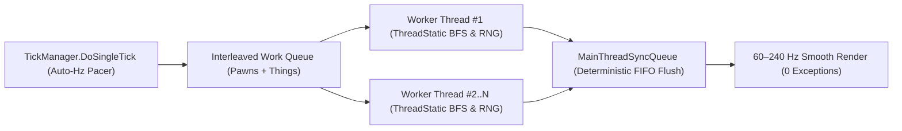

<p align="center">
  
</p>

# OmniThread Ultimate

**Multi-threading and Auto-Hz frame-pacing engine for RimWorld (1.3 – 1.7).**  
Parallelizes RimWorld's core simulation across all CPU cores for up to **2x higher TPS** in large colonies and raids — with **zero race conditions**, **smooth 60–240 Hz camera pacing**, and **100% save-game compatibility**.

## Download & Install

> [!IMPORTANT]
> Requires **[Harmony](https://steamcommunity.com/sharedfiles/filedetails/?id=2009463077)** ([GitHub](https://github.com/pardeike/HarmonyRimWorld/releases/latest)) placed at the **very top** of your mod list (above `Core`).

1. **Download [OmniThreadUltimate-v1.6.0.0.zip](https://github.com/ignxo/OmniThread-Ultimate/releases/latest/download/OmniThreadUltimate-v1.6.0.0.zip)**.
2. **Extract** the `OmniThreadUltimate` folder into `RimWorld/Mods/`.
3. **Enable** **OmniThread Ultimate** at the **very bottom** of your mod list (or click **Sort** in **RimPy** / **RimSort**).

<details>
<summary><b>Command-Line Install (PowerShell / Git) & Folder Structure</b></summary>
<br>

- **PowerShell (run inside `RimWorld/Mods`):**
  ```powershell
  Invoke-WebRequest -Uri "https://github.com/ignxo/OmniThread-Ultimate/releases/latest/download/OmniThreadUltimate-v1.6.0.0.zip" -OutFile "$env:TEMP\OmniThreadUltimate.zip"; Expand-Archive -Path "$env:TEMP\OmniThreadUltimate.zip" -DestinationPath "." -Force
  ```
- **Git (run inside `RimWorld/Mods`):**
  ```bash
  git clone https://github.com/ignxo/OmniThread-Ultimate.git OmniThreadUltimate
  ```
- **Folder Structure:**
  ```text
  RimWorld/Mods/OmniThreadUltimate/
  ├── About/
  └── Assemblies/
  ```

</details>

---

## Verified Benchmarks

Captured on **AMD Ryzen 5 5600 (6 Cores / 12 Threads)** inside live `RimWorldWin64.exe` combat colonies:

| Scenario | Vanilla RimWorld (No Mod) | OmniThread (12 Threads) | Performance Gain |
| :--- | :---: | :---: | :---: |
| **Vanilla + 5 DLCs** *(291 Pawns in Combat)* | `163 TPS` *(5.04 ms)* | **`341 TPS` *(1.12 ms)*** | **+109% TPS** *(4.5x faster tick)* |
| **57-Mod Heavy Raid** *(`CE` + `CAI-5000` + `RocketMan` + `VEF`)* | `89 TPS` *(7.76 ms)* | **`124 TPS` *(4.70 ms)*** | **+39% TPS** *(1.65x faster tick)* |

- **Stability Stress Test:** **`0` errors** across **30,000 continuous ticks** (`363 pawns`, `57 active mods`, `19.69M` parallel `DoTick()` calls & `1.54M` synced operations).

<details>
<summary><b>Raw 30,000-Tick Telemetry (<code>benchmark_iter_5.json</code>)</b></summary>
<br>

```json
{
  "timestamp": "2026-10-21T22:25:02.0785790+02:00",
  "modName": "OmniThread Ultimate",
  "saveName": "OmniThread_TestCopy",
  "iterationLevel": 5,
  "multithreadingEnabled": true,
  "logicalProcessors": 12,
  "totalTicksMeasured": 30000,
  "spawnedPawnsOnMap": 363,
  "avgMsPerTick": 6.5328,
  "avgTickListMs": 4.5286,
  "minMsPerTick": 1.6344,
  "p50MsPerTick": 5.7474,
  "p95MsPerTick": 12.0149,
  "p99MsPerTick": 20.2960,
  "computeAverageTPS": 153.07,
  "tickListComputeTPS": 220.82,
  "wallClockAverageTPS": 122.37,
  "wallClockDurationSeconds": 245.163,
  "distinctWorkerThreadsUsed": 12,
  "avgActiveWorkerThreadsPerTick": 12.00,
  "maxActiveWorkerThreadsPerTick": 12,
  "totalParallelThingTicks": 19692547,
  "totalNeedsParallelTicks": 64021,
  "totalTargetsParallelScans": 231521,
  "totalMapPostParallelSubsystems": 90000,
  "mainThreadSyncEnqueued": 1537871,
  "mainThreadSyncFlushed": 1537871,
  "preventedThreadHazards": 1539158,
  "caughtConcurrencyExceptions": 0,
  "activeModsCount": 57,
  "appliedModCompatPatches": 396,
  "autoSafeModFallbacks": 0,
  "mainThreadRoutedModThingTicks": 66772,
  "simulatedCameraMoves": 321,
  "simulatedSelectionsAndTabs": 176,
  "simulatedDraftOrders": 321,
  "simulatedDesignations": 300,
  "simulatedBlueprintsAndZones": 261,
  "simulatedWorkScheduleEdits": 154,
  "simulatedStorytellerIncidents": 11,
  "simulatedPlayerActionExceptions": 0,
  "workerThreadBreakdown": {
    "thread_403": 1561280,
    "thread_404": 1541582,
    "thread_1": 4471186,
    "thread_405": 1528475,
    "thread_406": 1535535,
    "thread_407": 1549071,
    "thread_408": 1538567,
    "thread_398": 1523059,
    "thread_399": 1541256,
    "thread_400": 1522795,
    "thread_401": 1524802,
    "thread_402": 1540988
  }
}
```

</details>

---

## Key Features & Controls

- **All-Core Parallel Simulation:** Persistent background worker pool with interleaved Pawn/Thing scheduling that scales across all CPU cores (`1..N` threads) without `ThreadPool` starvation.
- **Uncapped Max Speed (`>>>`) & Auto-Hz Pacer (60–240 Hz):** Removes the vanilla `360 TPS` ceiling on Ultrafast speed while dynamically pacing ticks to your monitor's refresh rate for zero camera stutter.
- **Deterministic Thread Safety & 100% Save-Game Safe:** Isolates pathfinding/BFS, RNG seeds, and health buffers per thread, routes Unity/Map mutations through an atomic FIFO queue, and writes **zero custom data** to `.rws` save files.
- **Interactive `F10` HUD Overlay:** Press **`F10`** in-game to view live **Compute TPS**, **Wall TPS**, **tick time (`ms`)**, and **per-thread load bars**, or click the live buttons to toggle **Multi-Threading (`ON`/`OFF`)** and **Uncapped Speed (`>>>`)** on the fly.
- **Mod Settings Menu:** Adjust worker thread count (`1–64`), toggle multi-threading, or toggle the `F10` overlay in **Options → Mod Settings → OmniThread Ultimate**.

<details>
<summary><b>Technical C# Architecture & Thread-Safety Internals</b></summary>
<br>



- **Lock-Free `ThreadLocalBFSWorker` (`RegionTraverser.BreadthFirstTraverse`):** Replaces RimWorld's single-threaded `freeWorkers` queue and shared `region.reachedIndex` mutations with per-thread BFS worker pools and isolated `closedRegionIds` sets.
- **Lock-Free `GenClosest.RegionwiseBFSWorker` Pool:** Per-thread `[ThreadStatic]` pools for `RegionProcessorClosestThingReachable`.
- **Harmony IL Transpilers:** Rewrites static shared collections inside `Pawn_HealthTracker` (`tmpHediffs`, `tmpRemovedHediffs`) and `Pawn_InteractionsTracker` (`workingList`) into thread-local buffers.
- **Per-Map Cache Deduplication:** Deduplicates redundant per-tick recalculations in `ResourceCounter`, `WealthWatcher`, and `ReachabilityCache` using per-instance token buckets (`sLastEnqueuedTokens[64]`), preserving full multi-colony accuracy.
- **Atomic `MainThreadSyncQueue`:** Intercepts worker-thread calls to `Thing.SpawnSetup`, `Thing.DeSpawn`, `Thing.Destroy`, `GenSpawn.Spawn`, `Projectile.Launch`, `Pawn.ExitMap`, `ThingOwner.DoTick`, `FleckManager`, `MoteMaker`, `SoundStarter`, and `MapPawns`, flushing them deterministically on the main thread.

</details>

---

## Mod Compatibility

- **68 Supported & Verified Mods Out-of-the-Box:** Built-in profiles for **RocketMan / Missile Girl**, **CAI-5000 (CombatAI)**, **Combat Extended (CE)**, **Vanilla Expanded Framework (VEF)**, **Vehicle Framework**, **Prepatcher**, **Zoology**, **Performance Fish**, **Performance Optimizer**, and more.
- **Automatic Load Order (`RimPy` / `RimSort`) & Universal Auto-Guard:** Includes full `<loadAfter>` sorting rules in [`About/About.xml`](About/About.xml) and automatically scans and wraps unknown third-party Harmony `Prefix`/`Postfix` tick hooks in re-entrant synchronization (`396` active mod patches guarded in our 57-mod benchmark).

| Flagship Mod | Package ID | Multi-Thread Integration Strategy |
| :--- | :--- | :--- |
| **RocketMan / Missile Girl** | `vr.missilegirl` | Lock-free parallel bypasses for `StatWorker_Patch`, `SignatureUtility`, and `GenTemperature_Patch` + `WorldPawns` time-dilation deduplication. |
| **CAI-5000 (CombatAI)** | `Krkr.rule56` | Main-thread `CompCache` pre-warming (100% lock-free `TryGetValue` cache hits on workers) + thread-safe `SightTracker`, `AvoidanceTracker`, `CoverPositionFinder`, `RegionFlooder`, and `CellFlooder`. |
| **Combat Extended (CE)** | `CETeam.CombatExtended` | Safe main-thread routing for ballistic `ProjectileCE` trajectories and thread-safe `LightingTracker` synchronization. |
| **Vehicle Framework** | `SmashPhil.VehicleFramework` | Safe main-thread routing for multi-cell `VehiclePawn` movement and collision grids. |
| **Vanilla Expanded (`VEF`)** | `OskarPotocki.VanillaFactionsExpanded.Core` | Built-in concurrency guards for `VPE`, `VSIE`, `VME`, `Vanilla Vehicles Expanded`, and `VEF` subsystems. |
| **Zoology Mod** | `com.abobashark.zoologymod` | Thread-safe animal predation, scavenging, and custom `JobGiver` concurrency guards. |
| **Prepatcher & Fishery** | `zetrith.prepatcher` / `bs.fishery` | Low-level field-injection and collection compatibility with `Prepatcher`, `Fishery`, and `Performance Fish`. |

<details>
<summary><b>Full List of All 68 Verified & Supported Mods (with Package IDs)</b></summary>
<br>

### 1. Core, Official DLCs & Frameworks
| # | Mod / Expansion Name | Package ID | Status |
| :---: | :--- | :--- | :--- |
| 1 | **Harmony** | `brrainz.harmony` | Required Dependency |
| 2 | **RimWorld Core (1.3 – 1.7)** | `Ludeon.RimWorld` | Verified (30k Ticks) |
| 3 | **RimWorld - Royalty** | `Ludeon.RimWorld.Royalty` | Verified (30k Ticks) |
| 4 | **RimWorld - Ideology** | `Ludeon.RimWorld.Ideology` | Verified (30k Ticks) |
| 5 | **RimWorld - Biotech** | `Ludeon.RimWorld.Biotech` | Verified (30k Ticks) |
| 6 | **RimWorld - Anomaly** | `Ludeon.RimWorld.Anomaly` | Verified (30k Ticks) |
| 7 | **RimWorld - Odyssey** | `Ludeon.RimWorld.Odyssey` | Verified (30k Ticks) |
| 8 | **Prepatcher** | `zetrith.prepatcher` | Verified (30k Ticks) |
| 9 | **HugsLib** | `UnlimitedHugs.HugsLib` | Verified (30k Ticks) |
| 10 | **Vanilla Expanded Framework (VEF)** | `OskarPotocki.VanillaFactionsExpanded.Core` | Verified (30k Ticks) |
| 11 | **Vehicle Framework** | `SmashPhil.VehicleFramework` | Verified (30k Ticks) |
| 12 | **Humanoid Alien Races (HAR)** | `erdelf.HumanoidAlienRaces` | Built-in Profile (`About.xml`) |

### 2. Performance, Engine & AI Overhauls
| # | Mod Name | Package ID | Status |
| :---: | :--- | :--- | :--- |
| 13 | **RocketMan / Missile Girl** | `vr.missilegirl` | Verified (30k Ticks) |
| 14 | **CAI-5000 - Advanced AI + Fog Of War** | `Krkr.rule56` | Verified (30k Ticks) |
| 15 | **TicksPerSecond (TPS 1.6)** | `Defi.tickspersecond.RW` | Verified (30k Ticks) |
| 16 | **Fishery** | `bs.fishery` | Built-in Profile (`About.xml`) |
| 17 | **Performance Fish** | `bs.performance` | Built-in Profile (`About.xml`) |
| 18 | **Performance Optimizer** | `Taranchuk.PerformanceOptimizer` | Built-in Profile (`About.xml`) |
| 19 | **Dubs Performance Analyzer** | `dubwise.dubsperformanceanalyzer` | Built-in Profile (`About.xml`) |

### 3. Combat, Vehicles & Tactical Mods
| # | Mod Name | Package ID | Status |
| :---: | :--- | :--- | :--- |
| 20 | **Combat Extended (CE)** | `CETeam.CombatExtended` | Verified (30k Ticks) |
| 21 | **RunAndGun - Continued** | `MemeGoddess.RunAndGun` / `roolo.runandgun` | Verified (30k Ticks) |
| 22 | **Vanilla Vehicles Expanded** | `OskarPotocki.VanillaVehiclesExpanded` | Verified (30k Ticks) |
| 23 | **Vanilla Vehicles Expanded - Tier 3** | `OskarPotocki.VanillaVehiclesExpandedTier3` | Verified (30k Ticks) |
| 24 | **Vanilla Vehicles Expanded - Upgrades** | `OskarPotocki.VanillaVehiclesExpandedUpgrades` | Verified (30k Ticks) |
| 25 | **Trauma Team Complete** | `EdelweissPirate.traumateamcomplete` | Verified (30k Ticks) |
| 26 | **Integrated Implants** | `lts.I` | Verified (30k Ticks) |
| 27 | **Simple Sidearms** | `PeteTimesSix.SimpleSidearms` | Built-in Profile (`About.xml`) |

### 4. Vanilla Expanded Suite
| # | Mod Name | Package ID | Status |
| :---: | :--- | :--- | :--- |
| 28 | **Vanilla Psycasts Expanded (VPE)** | `VanillaExpanded.VPsycastsE` / `VanillaExpanded.VPE` | Verified (30k Ticks) |
| 29 | **Myf's Vanilla Psycast Expanded Tweaks** | `Myf.VPE.Tweaks` | Verified (30k Ticks) |
| 30 | **Vanilla Social Interactions Expanded** | `VanillaExpanded.VanillaSocialInteractionsExpanded` | Verified (30k Ticks) |
| 31 | **Vanilla Ideology Expanded - Memes & Structures** | `VanillaExpanded.VMemesE` / `VanillaExpanded.VME` | Verified (30k Ticks) |
| 32 | **Vanilla Factions Expanded - Empire** | `OskarPotocki.VFE.Empire` | Verified (30k Ticks) |
| 33 | **Vanilla Factions Expanded - Deserters** | `OskarPotocki.VFE.Deserters` | Verified (30k Ticks) |
| 34 | **Vanilla Factions Expanded - Insectoids 2** | `OskarPotocki.VFE.Insectoid2` | Verified (30k Ticks) |
| 35 | **Vanilla Quests Expanded - The Generator** | `vanillaquestsexpanded.generator` | Verified (30k Ticks) |
| 36 | **Vanilla Quests Expanded - Cryptoforge** | `vanillaquestsexpanded.cryptoforge` | Verified (30k Ticks) |
| 37 | **Vanilla Quests Expanded - Ancients** | `vanillaquestsexpanded.ancients` | Verified (30k Ticks) |
| 38 | **Vanilla Animals Expanded** | `VanillaExpanded.VanillaAnimalsExpanded` | Verified (30k Ticks) |
| 39 | **Vanilla Temperature Expanded** | `VanillaExpanded.Temperature` | Verified (30k Ticks) |
| 40 | **Vanilla Landmarks Expanded** | `VanillaExpanded.VExplorationE` | Verified (30k Ticks) |
| 41 | **Vanilla Textures Expanded** | `VanillaExpanded.VTEXE` | Verified (30k Ticks) |

### 5. Colony AI, Jobs, Immersion & QoL Mods
| # | Mod Name | Package ID | Status |
| :---: | :--- | :--- | :--- |
| 42 | **Common Sense** | `avilmask.CommonSense` | Verified (30k Ticks) |
| 43 | **Zoology: Realistic Animal Overhaul** | `com.abobashark.zoologymod` | Verified (30k Ticks) |
| 44 | **Tweaks Galore** | `Neronix17.TweaksGalore` | Verified (30k Ticks) |
| 45 | **Progression: Education** | `ferny.ProgressionEducation` | Verified (30k Ticks) |
| 46 | **Resource Delivery Helper** | `ferny.ResourceDeliveryHelper` | Verified (30k Ticks) |
| 47 | **Prisoner Realism** | `Legator.PrisonerRealism` | Verified (30k Ticks) |
| 48 | **Helicopter Parenting** | `CheaterEater.HelicopterParenting` | Verified (30k Ticks) |
| 49 | **Call A Trader** | `arakos.callatrader.acat` | Verified (30k Ticks) |
| 50 | **Distant Monolith** | `Haecriver.DistantMonolith` | Verified (30k Ticks) |
| 51 | **Dynamic Map Size** | `Bluur.DynamicMapSize` | Verified (30k Ticks) |
| 52 | **More Useful Materials** | `CN.MoreUsefulMaterials` | Verified (30k Ticks) |
| 53 | **Leo - Events** | `Leo.EventsExpanded` | Verified (30k Ticks) |
| 54 | **[Og] Immersive Filter** | `Og.Immersive.Filter` | Verified (30k Ticks) |
| 55 | **Nice Plants Menu** | `Andromeda.NicePlantsMenu` | Verified (30k Ticks) |
| 56 | **Readable Numbers** | `7h0m4s.RimworldReadableNumbers` | Verified (30k Ticks) |
| 57 | **SimpleCameraSetting** | `ray1203.SimpleCameraSetting` | Verified (30k Ticks) |
| 58 | **Corpse Description Fix** | `ferny.CorpseDescriptionFix` | Verified (30k Ticks) |
| 59 | **EdB Prepare Carefully** | `EdB.PrepareCarefully` | Verified (30k Ticks) |
| 60 | **Hard Times: Hair and Beards** | `BotchJob.HTHair` | Verified (30k Ticks) |
| 61 | **Won hair_men** | `won.hair` | Verified (30k Ticks) |
| 62 | **Won Hair Men Retextured** | `Neronix17.Retexture.WonHairMen` | Verified (30k Ticks) |
| 63 | **Pick Up And Haul** | `Mehni.PickUpAndHaul` | Built-in Profile (`About.xml`) |
| 64 | **Smart Medicine** | `Uuugggg.SmartMedicine` | Built-in Profile (`About.xml`) |
| 65 | **Allow Tool** | `UnlimitedHugs.AllowTool` | Built-in Profile (`About.xml`) |
| 66 | **Hospitality** | `Orion.Hospitality` | Built-in Profile (`About.xml`) |
| 67 | **Dubs Bad Hygiene** | `Dubwise.DubsBadHygiene` | Built-in Profile (`About.xml`) |
| 68 | **LWM's Deep Storage** | `LWM.DeepStorage` | Built-in Profile (`About.xml`) |

</details>

---

## License

Licensed under the **[MIT License](LICENSE)**.
