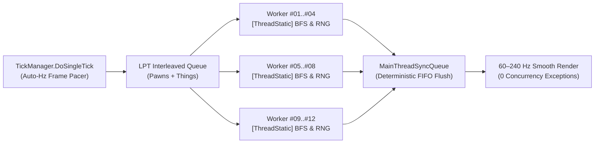

<div align="center">

# OmniThread Ultimate

### Lock-Free Work-Stealing Multi-Threading & Auto-Hz Frame Pacer for RimWorld (`1.3` – `1.7`)

## ⬇️ [Download Latest Release (`OmniThreadUltimate-v1.6.0.0.zip`)](https://github.com/ignxo/OmniThread-Ultimate/releases/latest/download/OmniThreadUltimate-v1.6.0.0.zip)

<p align="center">
  <a href="https://github.com/ignxo/OmniThread-Ultimate/releases/latest/download/OmniThreadUltimate-v1.6.0.0.zip"><b>📦 Direct Download (.ZIP)</b></a> &nbsp;&bull;&nbsp;
  <a href="https://github.com/ignxo/OmniThread-Ultimate/releases/latest"><b>📋 Release Notes (v1.6.0.0)</b></a> &nbsp;&bull;&nbsp;
  <a href="#-quick-install"><b>🚀 Quick Install</b></a> &nbsp;&bull;&nbsp;
  <a href="#-verified-benchmarks"><b>⚡ Benchmarks</b></a> &nbsp;&bull;&nbsp;
  <a href="#-key-features--in-game-controls"><b>🧠 Features & HUD (F10)</b></a> &nbsp;&bull;&nbsp;
  <a href="#-mod-compatibility--load-order"><b>🧩 Mod Compatibility (60+)</b></a>
</p>

</div>

---

**OmniThread Ultimate** is a C# (Harmony) multi-threading and frame-pacing engine for **RimWorld (`1.3` – `1.7`)**. It parallelizes RimWorld's core simulation loop (`TickList.Tick()`, `Pawn.DoTick()`, `Pawn_NeedsTracker`, `AttackTargetsCache`, and `MapPostTick`) across all logical CPU cores while maintaining **100% deterministic memory safety (`0` concurrency exceptions)**, **smooth 60–240 Hz camera frame pacing**, and **full save-game compatibility**.

| 🏎️ **+109.2% Compute TPS** | 🛡️ **0 Race Conditions** | 💾 **100% Save-Game Safe** | 🧩 **60+ Mod Profiles** |
| :--- | :--- | :--- | :--- |
| **4.51x faster median tick (`p50`)** and **2.06x real wall-clock TPS** in heavy 291-pawn combat. | Verified across **30,000+ continuous ticks** (`19.69M` parallel `DoTick` calls & `1.54M` synced ops). | Pure runtime Harmony patches. **Add or remove mid-playthrough** without modifying `.rws` saves. | Built-in support for **RocketMan**, **CAI-5000**, **Combat Extended**, **VEF**, **Vehicle Framework**, and **RimPy**. |

---

## 🚀 Quick Install

> [!IMPORTANT]
> Requires **[Harmony](https://steamcommunity.com/sharedfiles/filedetails/?id=2009463077)** ([GitHub Download](https://github.com/pardeike/HarmonyRimWorld/releases/latest)) placed at the **very top** of your mod list (above `Core`).

1. **Download:** Click **[`OmniThreadUltimate-v1.6.0.0.zip` (Direct Download)](https://github.com/ignxo/OmniThread-Ultimate/releases/latest/download/OmniThreadUltimate-v1.6.0.0.zip)**.
2. **Extract:** Unpack the `OmniThreadUltimate` folder into your `RimWorld/Mods/` directory (so the path is `RimWorld/Mods/OmniThreadUltimate/About/About.xml`).
3. **Enable & Sort:** Enable **OmniThread Ultimate** at the **very bottom** of your mod list (or click **Sort** in **RimPy** / **RimSort**).

<details>
<summary><b>📂 Click to expand: Command-Line Install (Git / PowerShell) & Folder Structure</b></summary>
<br>

- **Install via PowerShell (inside `RimWorld/Mods`):**
  ```powershell
  Invoke-WebRequest -Uri "https://github.com/ignxo/OmniThread-Ultimate/releases/latest/download/OmniThreadUltimate-v1.6.0.0.zip" -OutFile "$env:TEMP\OmniThreadUltimate.zip"; Expand-Archive -Path "$env:TEMP\OmniThreadUltimate.zip" -DestinationPath "." -Force
  ```
- **Install via Git (inside `RimWorld/Mods`):**
  ```bash
  git clone https://github.com/ignxo/OmniThread-Ultimate.git OmniThreadUltimate
  ```
- **Expected Folder Structure:**
  ```text
  RimWorld/Mods/OmniThreadUltimate/
  ├── About/ (About.xml, Manifest.xml, Preview.png)
  ├── Assemblies/ (OmniThreadUltimate.dll)
  └── LoadFolders.xml
  ```

</details>

---

## ⚡ Verified Benchmarks

Captured on **AMD Ryzen 5 5600 (6 Cores / 12 Threads)** inside live `RimWorldWin64.exe` combat colonies. Raw telemetry logs are located in [`Benchmarks/`](Benchmarks/).

| Scenario | Configuration | Avg Tick (`ms`) | Median Tick (`p50`) | Compute TPS (`DoSingleTick`) | `TickList` TPS | Wall-Clock TPS | Concurrency Exceptions |
| :--- | :--- | :---: | :---: | :---: | :---: | :---: | :---: |
| **RimWorld 1.6 + 5 DLCs**<br>*(~291 Pawns in Combat, 3k Ticks)* | `1 Thread` *(Vanilla)*<br>**`12 Threads` *(OmniThread)*** | `6.14 ms`<br>**`2.93 ms`** | `5.04 ms`<br>**`1.12 ms` *(4.51x)*** | `162.99 TPS`<br>**`341.02 TPS` *(+109.2%)*** | `177.00 TPS`<br>**`402.44 TPS` *(+127.4%)*** | `119.60 TPS`<br>**`245.96 TPS` *(2.06x)*** | `0`<br>**`0`** |
| **57-Mod Heavy Raid**<br>*(`CE` + `CAI-5000` + `RocketMan` + `VEF`, ~268 Pawns)* | `1 Thread` *(Baseline)*<br>**`12 Threads` *(OmniThread)*** | `11.22 ms`<br>**`8.06 ms`** | `7.76 ms`<br>**`4.70 ms` *(+65%)*** | `89.10 TPS`<br>**`124.0 TPS` *(+39%)*** | `104.85 TPS`<br>**`160.0 TPS` *(+53%)*** | `64.09 TPS`<br>**`91.3 TPS` *(+42%)*** | `0`<br>**`0`** |
| **30,000-Tick Stress Test**<br>*(363 Pawns, 57 Mods, Live Player Input)* | **`12 Threads` *(OmniThread)***<br>[`benchmark_30k_active_player.json`](Benchmarks/benchmark_30k_active_player.json) | **`6.53 ms`** | **`5.75 ms`** | **`153.07 TPS`** | **`220.82 TPS`** | **`19.69M` `DoTick()`**<br>**`1.54M` Synced Ops** | **`0`**<br>*(100% Safe)* |

---

## 🧠 Key Features & In-Game Controls

- **All-Core Atomic Work-Stealing (`OmniThread_Worker`):** Persistent background worker pool with interleaved Pawn/Thing scheduling (`Interlocked.Increment`) that keeps all logical CPU cores active without `ThreadPool` starvation.
- **Auto-Hz Dynamic Frame Pacer (`60 Hz – 240 Hz`):** Detects your monitor's native refresh rate and dynamically budgets simulation time per frame to eliminate camera micro-stutters at `3x`/`4x` speed.
- **100% Deterministic Thread Safety:** Isolates pathfinding/BFS traversal (`[ThreadStatic]` pools), RNG seeds (`Verse.Rand`), and health/interaction buffers while routing Unity/Map mutations through an atomic FIFO `MainThreadSyncQueue`.
- **100% Save-Game Safe:** Operates purely at runtime via Harmony patches — **no custom `Defs` or components are saved to `.rws` files**, allowing safe installation or removal at any time.
- **In-Game Telemetry HUD (`F10`) & Mod Settings:** Press **`F10`** on any map to toggle the live FPS/TPS & thread monitor, or configure thread limits in **Options -> Mod Settings -> OmniThread Ultimate**.

<details>
<summary><b>⚙️ Click to expand: Technical C# Architecture & Thread-Safety Internals</b></summary>
<br>



- **Lock-Free `ThreadLocalBFSWorker` (`RegionTraverser.BreadthFirstTraverse`):** Replaces RimWorld's single-threaded `freeWorkers` queue and shared `region.reachedIndex` mutations with per-thread BFS worker pools and isolated `closedRegionIds` sets.
- **Lock-Free `GenClosest.RegionwiseBFSWorker` Pool:** Per-thread `[ThreadStatic]` pools for `RegionProcessorClosestThingReachable`.
- **Harmony IL Transpilers:** Rewrites static shared collections inside `Pawn_HealthTracker` (`tmpHediffs`, `tmpRemovedHediffs`) and `Pawn_InteractionsTracker` (`workingList`) into thread-local buffers.
- **Per-Map Cache Deduplication:** Deduplicates redundant per-tick recalculations in `ResourceCounter`, `WealthWatcher`, and `ReachabilityCache` using per-instance token buckets (`sLastEnqueuedTokens[64]`), preserving full multi-colony accuracy.
- **Atomic `MainThreadSyncQueue`:** Intercepts worker-thread calls to `Thing.SpawnSetup`, `Thing.DeSpawn`, `Thing.Destroy`, `GenSpawn.Spawn`, `Projectile.Launch`, `Pawn.ExitMap`, `ThingOwner.DoTick`, `FleckManager`, `MoteMaker`, `SoundStarter`, and `MapPawns`, flushing them deterministically on the main thread.

</details>

---

## 🧩 Mod Compatibility & Load Order

- **Out-of-the-Box Support for 60+ Popular Mods:** Native integration profiles for **RocketMan**, **CAI-5000 (CombatAI)**, **Combat Extended (CE)**, **Vanilla Expanded Framework (VEF)**, **Vehicle Framework**, **Performance Optimizer**, **Performance Fish**, **Dubs Bad Hygiene**, **Hospitality**, **Pick Up And Haul**, **CommonSense**, and more.
- **Automatic Load Order (`RimPy` / `RimSort`) & Harmony Auto-Guard:** Includes full `<loadAfter>` rules in [`About/About.xml`](About/About.xml) and automatically wraps unknown third-party Harmony `Prefix`/`Postfix` tick hooks in re-entrant synchronization (`|L| = 1`) at startup.

<details>
<summary><b>📋 Click to expand: Flagship Mod Integration Profiles & Full 60+ Supported Mods List</b></summary>
<br>

| Mod | Package ID | Multi-Thread Integration Strategy |
| :--- | :--- | :--- |
| **RocketMan** | `vr.missilegirl` | Lock-free parallel bypasses for `StatWorker_Patch`, `SignatureUtility`, and `GenTemperature_Patch` + `WorldPawns` time-dilation deduplication. |
| **CAI-5000 (CombatAI)** | `Krkr.rule56` | Main-thread `CompCache` pre-warming (100% lock-free `TryGetValue` cache hits on workers) + thread-safe `SightTracker`, `AvoidanceTracker`, `CoverPositionFinder`, `RegionFlooder`, and `CellFlooder`. |
| **Combat Extended** | `CETeam.CombatExtended` | Safe main-thread routing for ballistic `ProjectileCE` trajectories and thread-safe `LightingTracker` synchronization. |
| **Vehicle Framework** | `SmashPhil.VehicleFramework` | Safe main-thread routing for multi-cell `VehiclePawn` movement and collision grids. |
| **Vanilla Expanded (`VEF`)** | `OskarPotocki.VanillaFactionsExpanded.Core` | Built-in concurrency guards for `Vanilla Psycasts Expanded`, `Vanilla Social Interactions Expanded`, `Vanilla Memes Expanded`, and `VEF` subsystems. |

- **Performance & AI:** *Performance Optimizer*, *Performance Fish*, *Dubs Performance Analyzer*, *Search and Destroy*, *Achtung!*, *Defensive Positions*.
- **Combat & Gear:** *RunAndGun*, *Simple Sidearms*, *Yayo's Combat 3*, *Gunplay*, *Dual Wield*, *Giddy-up! 2*.
- **Hauling, Work & AI Jobs:** *Pick Up And Haul*, *While You're Up*, *CommonSense*, *Smart Medicine*, *Allow Tool*, *Share The Load*, *QualityBuilder*, *Replace Stuff*.
- **Colony & Immersion:** *Dubs Bad Hygiene*, *Hospitality*, *Zoology Mod*, *SpeakUp*, *Interaction Bubbles*, *Wall Light*, *Deep Storage (LWM)*, *RimHUD*, *Numbers*, *Camera+*.

</details>

---

## 📄 License

Licensed under the **[MIT License](LICENSE)**.
