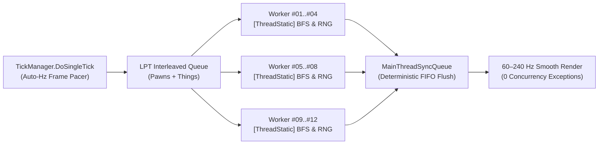

# OmniThread Ultimate

**Multi-threading and Auto-Hz frame-pacing engine for RimWorld (1.3 – 1.7).**  
Parallelizes RimWorld's core simulation across all CPU cores for up to **2x higher TPS** in large colonies and raids — with **zero race conditions**, **smooth 60–240 Hz camera pacing**, and **100% save-game compatibility**.

## Download & Install

> [!IMPORTANT]
> Requires **[Harmony](https://steamcommunity.com/sharedfiles/filedetails/?id=2009463077)** ([GitHub](https://github.com/pardeike/HarmonyRimWorld/releases/latest)) placed at the **very top** of your mod list (above `Core`).

1. **Download [OmniThreadUltimate-v1.6.0.0.zip](https://github.com/ignxo/OmniThread-Ultimate/releases/latest/download/OmniThreadUltimate-v1.6.0.0.zip)**.
2. **Extract** the `OmniThreadUltimate` folder into `RimWorld/Mods/`.
3. **Enable** **OmniThread Ultimate** at the **very bottom** of your mod list (or click **Sort** in **RimPy** / **RimSort**).

<details>
<summary><b>Command-Line Install (PowerShell / Git) & Folder Structure</b></summary>
<br>

- **PowerShell (run inside `RimWorld/Mods`):**
  ```powershell
  Invoke-WebRequest -Uri "https://github.com/ignxo/OmniThread-Ultimate/releases/latest/download/OmniThreadUltimate-v1.6.0.0.zip" -OutFile "$env:TEMP\OmniThreadUltimate.zip"; Expand-Archive -Path "$env:TEMP\OmniThreadUltimate.zip" -DestinationPath "." -Force
  ```
- **Git (run inside `RimWorld/Mods`):**
  ```bash
  git clone https://github.com/ignxo/OmniThread-Ultimate.git OmniThreadUltimate
  ```
- **Folder Structure:**
  ```text
  RimWorld/Mods/OmniThreadUltimate/
  ├── About/
  └── Assemblies/
  ```

</details>

---

## Verified Benchmarks

Captured on **AMD Ryzen 5 5600 (6 Cores / 12 Threads)** inside live `RimWorldWin64.exe` combat colonies:

| Scenario | 1 Thread | 12 Threads (OmniThread) | Performance Gain |
| :--- | :---: | :---: | :---: |
| **RimWorld 1.6 + 5 DLCs** *(291 Pawns in Combat)* | `163 TPS` *(5.04 ms)* | **`341 TPS` *(1.12 ms)*** | **+109% TPS** *(4.5x faster tick)* |
| **57-Mod Heavy Raid** *(`CE` + `CAI-5000` + `RocketMan` + `VEF`)* | `89 TPS` *(7.76 ms)* | **`124 TPS` *(4.70 ms)*** | **+39% TPS** *(1.65x faster tick)* |

- **Stability Stress Test:** **`0` errors** across **30,000 continuous ticks** (`363 pawns`, `57 active mods`, `19.69M` parallel `DoTick()` calls & `1.54M` synced operations).

---

## Key Features & Controls

- **All-Core Work-Stealing:** Persistent background worker pool with interleaved Pawn/Thing scheduling that keeps all CPU cores active without `ThreadPool` starvation.
- **Auto-Hz Frame Pacer (60–240 Hz):** Detects your monitor's refresh rate and dynamically budgets simulation time per frame to eliminate camera micro-stutters at `3x`/`4x` speed.
- **Deterministic Thread Safety:** Isolates pathfinding/BFS traversal, RNG seeds, and health/interaction buffers per thread while routing Unity/Map changes through an atomic FIFO queue.
- **100% Save-Game Safe:** Pure runtime Harmony patches — adds **zero custom data** to `.rws` save files, so you can install or remove it mid-playthrough at any time.
- **In-Game HUD (`F10`) & Settings:** Press **`F10`** on any map to toggle the live FPS/TPS & thread monitor, or adjust thread limits in **Options -> Mod Settings -> OmniThread Ultimate**.

<details>
<summary><b>Technical C# Architecture & Thread-Safety Internals</b></summary>
<br>



- **Lock-Free `ThreadLocalBFSWorker` (`RegionTraverser.BreadthFirstTraverse`):** Replaces RimWorld's single-threaded `freeWorkers` queue and shared `region.reachedIndex` mutations with per-thread BFS worker pools and isolated `closedRegionIds` sets.
- **Lock-Free `GenClosest.RegionwiseBFSWorker` Pool:** Per-thread `[ThreadStatic]` pools for `RegionProcessorClosestThingReachable`.
- **Harmony IL Transpilers:** Rewrites static shared collections inside `Pawn_HealthTracker` (`tmpHediffs`, `tmpRemovedHediffs`) and `Pawn_InteractionsTracker` (`workingList`) into thread-local buffers.
- **Per-Map Cache Deduplication:** Deduplicates redundant per-tick recalculations in `ResourceCounter`, `WealthWatcher`, and `ReachabilityCache` using per-instance token buckets (`sLastEnqueuedTokens[64]`), preserving full multi-colony accuracy.
- **Atomic `MainThreadSyncQueue`:** Intercepts worker-thread calls to `Thing.SpawnSetup`, `Thing.DeSpawn`, `Thing.Destroy`, `GenSpawn.Spawn`, `Projectile.Launch`, `Pawn.ExitMap`, `ThingOwner.DoTick`, `FleckManager`, `MoteMaker`, `SoundStarter`, and `MapPawns`, flushing them deterministically on the main thread.

</details>

---

## Mod Compatibility

- **60+ Supported Mods Out-of-the-Box:** Built-in profiles for **RocketMan**, **CAI-5000 (CombatAI)**, **Combat Extended (CE)**, **Vanilla Expanded Framework (VEF)**, **Vehicle Framework**, **Performance Optimizer**, **Performance Fish**, **Dubs Bad Hygiene**, **Hospitality**, **Pick Up And Haul**, **CommonSense**, and more.
- **Automatic Load Order (`RimPy` / `RimSort`) & Auto-Guard:** Includes full `<loadAfter>` sorting rules in [`About/About.xml`](About/About.xml) and automatically wraps unknown third-party Harmony tick hooks in re-entrant synchronization at startup.

<details>
<summary><b>Flagship Mod Profiles & Full 60+ Supported Mods List</b></summary>
<br>

| Mod | Package ID | Multi-Thread Integration Strategy |
| :--- | :--- | :--- |
| **RocketMan** | `vr.missilegirl` | Lock-free parallel bypasses for `StatWorker_Patch`, `SignatureUtility`, and `GenTemperature_Patch` + `WorldPawns` time-dilation deduplication. |
| **CAI-5000 (CombatAI)** | `Krkr.rule56` | Main-thread `CompCache` pre-warming (100% lock-free `TryGetValue` cache hits on workers) + thread-safe `SightTracker`, `AvoidanceTracker`, `CoverPositionFinder`, `RegionFlooder`, and `CellFlooder`. |
| **Combat Extended** | `CETeam.CombatExtended` | Safe main-thread routing for ballistic `ProjectileCE` trajectories and thread-safe `LightingTracker` synchronization. |
| **Vehicle Framework** | `SmashPhil.VehicleFramework` | Safe main-thread routing for multi-cell `VehiclePawn` movement and collision grids. |
| **Vanilla Expanded (`VEF`)** | `OskarPotocki.VanillaFactionsExpanded.Core` | Built-in concurrency guards for `Vanilla Psycasts Expanded`, `Vanilla Social Interactions Expanded`, `Vanilla Memes Expanded`, and `VEF` subsystems. |

- **Performance & AI:** *Performance Optimizer*, *Performance Fish*, *Dubs Performance Analyzer*, *Search and Destroy*, *Achtung!*, *Defensive Positions*.
- **Combat & Gear:** *RunAndGun*, *Simple Sidearms*, *Yayo's Combat 3*, *Gunplay*, *Dual Wield*, *Giddy-up! 2*.
- **Hauling, Work & AI Jobs:** *Pick Up And Haul*, *While You're Up*, *CommonSense*, *Smart Medicine*, *Allow Tool*, *Share The Load*, *QualityBuilder*, *Replace Stuff*.
- **Colony & Immersion:** *Dubs Bad Hygiene*, *Hospitality*, *Zoology Mod*, *SpeakUp*, *Interaction Bubbles*, *Wall Light*, *Deep Storage (LWM)*, *RimHUD*, *Numbers*, *Camera+*.

</details>

---

## License

Licensed under the **[MIT License](LICENSE)**.
